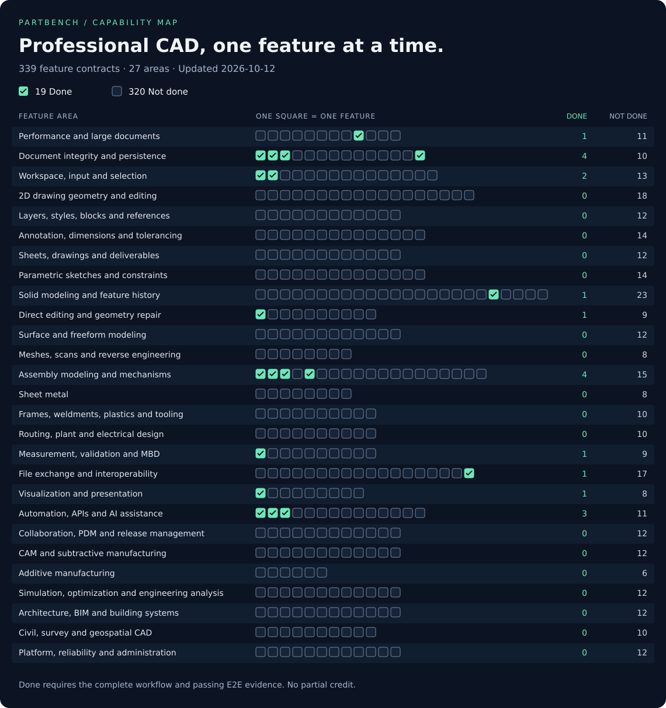

# Partbench

Partbench is an open-source, browser-native, AI-native CAD application.

CADOps is the center. cad-core is the document authority. OCCT/WASM is the
geometry authority. Meshes, picks, and previews are derived display.

V22–V26, the [agent runtime release](docs/agent-runtime.md), and the
[connected robot arm fixes](docs/robot-arm-fixes.md) and
[parametric gearbox workflow](docs/gearbox-workflow.md) are complete.
Native formats remain `web-cad.project.v22` and `partbench.wcad.v2`.

Start at [AGENTS.md](./AGENTS.md).

<!-- CAD_MATRIX_OVERVIEW:START -->

## Professional CAD feature map

[](docs/cad-feature-matrix.md)

**25 Done · 314 Not done.** Every feature is binary: its entire acceptance contract passes, or it is Not done. Existing code without complete workflow evidence stays Not done. No partial statuses or percentage score.

[Browse the feature checklist](#feature-checklist) · [Read acceptance criteria and evidence](docs/cad-feature-matrix.md) · [See implementation order](docs/parity-roadmap.md)

<!-- CAD_MATRIX_OVERVIEW:END -->

## Setup

Node.js 22 and pnpm 10.

```sh
pnpm install
pnpm dev
```

Verify (matrix integrity, typecheck and consolidated E2E journeys):

```sh
pnpm verify
```

E2E checks (Bun 1.4.2+ and Chrome required):

```sh
pnpm test
# Focus on one workflow:
pnpm test:e2e -- interchange
```

Connected local MCP session:

```sh
pnpm --filter @web-cad/mcp-stdio-server start
```

Headless MCP session (Node 22; build once, then run the executable):

```sh
pnpm --filter @web-cad/mcp-stdio-server build
mkdir -p ./cad-workspace
node packages/mcp-stdio-server/dist/stdio.js --headless --workspace ./cad-workspace
```

See [agent runtime usage](docs/agent-runtime-usage.md) for modeling, exact
inspection, revision, native save/reopen, STEP export, and current limits.
`pnpm smoke:agent-runtime` verifies the two complete headless journeys locally;
`pnpm benchmark:cad-runtime` reports startup and warm-operation measurements.

Only E2E tests; no unit or component tests. See [testing policy](docs/verification.md)
and the [CAD parity roadmap](docs/parity-roadmap.md).

Choose the next feature contract with `pnpm cad:matrix --next`. Edit
`docs/cad-feature-matrix.json` and run `pnpm cad:matrix` to update the binary
feature table, README graphic and checklist.

<!-- CAD_MATRIX_FEATURES:START -->

## Feature checklist

All 339 features are listed below, grouped into 27 areas. **Checked = Done; unchecked = Not done.** Follow a feature ID for its full completion criteria and evidence.

Generated from [the matrix source](docs/cad-feature-matrix.json) with `pnpm cad:matrix`. Use `pnpm cad:matrix --next` to choose the next contract.

<details>
<summary>Performance and large documents — 3 Done · 9 Not done</summary>

- [x] [PERF-001](docs/cad-feature-matrix.md#perf-001) Cold usable assembly view
- [ ] [PERF-002](docs/cad-feature-matrix.md#perf-002) Cold exact selection readiness
- [x] [PERF-003](docs/cad-feature-matrix.md#perf-003) Progressive assembly import
- [ ] [PERF-004](docs/cad-feature-matrix.md#perf-004) Cached native reopen latency
- [ ] [PERF-005](docs/cad-feature-matrix.md#perf-005) Interactive edit latency
- [ ] [PERF-006](docs/cad-feature-matrix.md#perf-006) Hardware viewport frame budget
- [ ] [PERF-007](docs/cad-feature-matrix.md#perf-007) Large drawing interaction
- [ ] [PERF-008](docs/cad-feature-matrix.md#perf-008) Memory-bounded long sessions
- [x] [PERF-009](docs/cad-feature-matrix.md#perf-009) Interruptible STEP preparation
- [ ] [PERF-010](docs/cad-feature-matrix.md#perf-010) Incremental geometry rebuild
- [ ] [PERF-011](docs/cad-feature-matrix.md#perf-011) Out-of-core assemblies
- [ ] [PERF-012](docs/cad-feature-matrix.md#perf-012) Repeatable performance corpus

</details>

<details>
<summary>Document integrity and persistence — 4 Done · 10 Not done</summary>

- [x] [DOC-001](docs/cad-feature-matrix.md#doc-001) Native editable save and reopen
- [x] [DOC-002](docs/cad-feature-matrix.md#doc-002) Transaction Undo and Redo
- [x] [DOC-003](docs/cad-feature-matrix.md#doc-003) Atomic rejected commands
- [ ] [DOC-004](docs/cad-feature-matrix.md#doc-004) Project units and precision
- [ ] [DOC-005](docs/cad-feature-matrix.md#doc-005) Project templates
- [ ] [DOC-006](docs/cad-feature-matrix.md#doc-006) Crash recovery
- [ ] [DOC-007](docs/cad-feature-matrix.md#doc-007) Autosave and restore points
- [ ] [DOC-008](docs/cad-feature-matrix.md#doc-008) Corrupt and unsupported file handling
- [ ] [DOC-009](docs/cad-feature-matrix.md#doc-009) Native schema migration
- [ ] [DOC-010](docs/cad-feature-matrix.md#doc-010) Multiple open documents
- [ ] [DOC-011](docs/cad-feature-matrix.md#doc-011) Document audit and repair
- [ ] [DOC-012](docs/cad-feature-matrix.md#doc-012) Project properties and metadata
- [ ] [DOC-013](docs/cad-feature-matrix.md#doc-013) Pack and transfer project dependencies
- [x] [DOC-014](docs/cad-feature-matrix.md#doc-014) Deterministic geometry persistence

</details>

<details>
<summary>Workspace, input and selection — 4 Done · 11 Not done</summary>

- [x] [UX-001](docs/cad-feature-matrix.md#ux-001) Fit, standard views and orbit
- [x] [UX-002](docs/cad-feature-matrix.md#ux-002) Occurrence selection
- [ ] [UX-003](docs/cad-feature-matrix.md#ux-003) Entity and subentity selection
- [ ] [UX-004](docs/cad-feature-matrix.md#ux-004) Window and crossing selection
- [ ] [UX-005](docs/cad-feature-matrix.md#ux-005) Command line and aliases
- [x] [UX-006](docs/cad-feature-matrix.md#ux-006) Precise coordinate input
- [x] [UX-007](docs/cad-feature-matrix.md#ux-007) Object snaps and tracking
- [ ] [UX-008](docs/cad-feature-matrix.md#ux-008) Grid, ortho and polar modes
- [ ] [UX-009](docs/cad-feature-matrix.md#ux-009) Named coordinate systems
- [ ] [UX-010](docs/cad-feature-matrix.md#ux-010) Direct manipulation grips
- [ ] [UX-011](docs/cad-feature-matrix.md#ux-011) Search and keyboard customization
- [ ] [UX-012](docs/cad-feature-matrix.md#ux-012) Keyboard and assistive access
- [ ] [UX-013](docs/cad-feature-matrix.md#ux-013) Touch, pen and 3D mouse input
- [ ] [UX-014](docs/cad-feature-matrix.md#ux-014) Multi-viewport workspaces
- [ ] [UX-015](docs/cad-feature-matrix.md#ux-015) Model browser organization

</details>

<details>
<summary>2D drawing geometry and editing — 1 Done · 17 Not done</summary>

- [x] [DRAW-001](docs/cad-feature-matrix.md#draw-001) Independent drafting document
- [ ] [DRAW-002](docs/cad-feature-matrix.md#draw-002) Lines, rays and construction lines
- [ ] [DRAW-003](docs/cad-feature-matrix.md#draw-003) Polylines and joined paths
- [ ] [DRAW-004](docs/cad-feature-matrix.md#draw-004) Circles and arcs
- [ ] [DRAW-005](docs/cad-feature-matrix.md#draw-005) Ellipses and elliptical arcs
- [ ] [DRAW-006](docs/cad-feature-matrix.md#draw-006) Splines and fit curves
- [ ] [DRAW-007](docs/cad-feature-matrix.md#draw-007) Rectangles and regular polygons
- [ ] [DRAW-008](docs/cad-feature-matrix.md#draw-008) Move, copy, rotate and scale
- [ ] [DRAW-009](docs/cad-feature-matrix.md#draw-009) Mirror and align
- [ ] [DRAW-010](docs/cad-feature-matrix.md#draw-010) Trim and extend
- [ ] [DRAW-011](docs/cad-feature-matrix.md#draw-011) Offset curves
- [ ] [DRAW-012](docs/cad-feature-matrix.md#draw-012) Fillet and chamfer curves
- [ ] [DRAW-013](docs/cad-feature-matrix.md#draw-013) Break, split, stretch and lengthen
- [ ] [DRAW-014](docs/cad-feature-matrix.md#draw-014) Rectangular, polar and path arrays
- [ ] [DRAW-015](docs/cad-feature-matrix.md#draw-015) Regions and 2D booleans
- [ ] [DRAW-016](docs/cad-feature-matrix.md#draw-016) Boundary extraction and cleanup
- [ ] [DRAW-017](docs/cad-feature-matrix.md#draw-017) Divide and measure along paths
- [ ] [DRAW-018](docs/cad-feature-matrix.md#draw-018) Image and PDF tracing

</details>

<details>
<summary>Layers, styles, blocks and references — 0 Done · 12 Not done</summary>

- [ ] [ORG-001](docs/cad-feature-matrix.md#org-001) Layer properties
- [ ] [ORG-002](docs/cad-feature-matrix.md#org-002) Layer filters and states
- [ ] [ORG-003](docs/cad-feature-matrix.md#org-003) Linetype and lineweight display
- [ ] [ORG-004](docs/cad-feature-matrix.md#org-004) Reusable blocks
- [ ] [ORG-005](docs/cad-feature-matrix.md#org-005) Block attributes and fields
- [ ] [ORG-006](docs/cad-feature-matrix.md#org-006) Dynamic blocks
- [ ] [ORG-007](docs/cad-feature-matrix.md#org-007) External drawing references
- [ ] [ORG-008](docs/cad-feature-matrix.md#org-008) Reference clipping and binding
- [ ] [ORG-009](docs/cad-feature-matrix.md#org-009) Raster, PDF and DGN underlays
- [ ] [ORG-010](docs/cad-feature-matrix.md#org-010) Groups and selection sets
- [ ] [ORG-011](docs/cad-feature-matrix.md#org-011) Drawing standards validation
- [ ] [ORG-012](docs/cad-feature-matrix.md#org-012) Property matching and purge

</details>

<details>
<summary>Annotation, dimensions and tolerancing — 1 Done · 13 Not done</summary>

- [ ] [ANN-001](docs/cad-feature-matrix.md#ann-001) Single-line and rich text
- [x] [ANN-002](docs/cad-feature-matrix.md#ann-002) Associative linear dimensions
- [ ] [ANN-003](docs/cad-feature-matrix.md#ann-003) Angular, radius and diameter dimensions
- [ ] [ANN-004](docs/cad-feature-matrix.md#ann-004) Ordinate, baseline and chain dimensions
- [ ] [ANN-005](docs/cad-feature-matrix.md#ann-005) Dimension styles and annotation scale
- [ ] [ANN-006](docs/cad-feature-matrix.md#ann-006) Tolerances, limits and fits
- [ ] [ANN-007](docs/cad-feature-matrix.md#ann-007) GD&T feature control frames
- [ ] [ANN-008](docs/cad-feature-matrix.md#ann-008) Leaders and multileaders
- [ ] [ANN-009](docs/cad-feature-matrix.md#ann-009) Hatches, fills and gradients
- [ ] [ANN-010](docs/cad-feature-matrix.md#ann-010) Tables and linked data
- [ ] [ANN-011](docs/cad-feature-matrix.md#ann-011) Center marks and centerlines
- [ ] [ANN-012](docs/cad-feature-matrix.md#ann-012) Surface finish and weld symbols
- [ ] [ANN-013](docs/cad-feature-matrix.md#ann-013) Revision clouds and revision tables
- [ ] [ANN-014](docs/cad-feature-matrix.md#ann-014) Fields and automatic labels

</details>

<details>
<summary>Sheets, drawings and deliverables — 0 Done · 12 Not done</summary>

- [ ] [SHEET-001](docs/cad-feature-matrix.md#sheet-001) Paper space and sheet layouts
- [ ] [SHEET-002](docs/cad-feature-matrix.md#sheet-002) Scaled and clipped viewports
- [ ] [SHEET-003](docs/cad-feature-matrix.md#sheet-003) Title blocks and sheet sets
- [ ] [SHEET-004](docs/cad-feature-matrix.md#sheet-004) Associative orthographic views
- [ ] [SHEET-005](docs/cad-feature-matrix.md#sheet-005) Section and broken-out views
- [ ] [SHEET-006](docs/cad-feature-matrix.md#sheet-006) Detail, auxiliary and broken views
- [ ] [SHEET-007](docs/cad-feature-matrix.md#sheet-007) Model-linked drawing dimensions
- [ ] [SHEET-008](docs/cad-feature-matrix.md#sheet-008) Hole tables and callouts
- [ ] [SHEET-009](docs/cad-feature-matrix.md#sheet-009) Assembly balloons and drawing BOM
- [ ] [SHEET-010](docs/cad-feature-matrix.md#sheet-010) Scale-correct PDF and printing
- [ ] [SHEET-011](docs/cad-feature-matrix.md#sheet-011) Batch publishing and plot presets
- [ ] [SHEET-012](docs/cad-feature-matrix.md#sheet-012) Drawing revision comparison

</details>

<details>
<summary>Parametric sketches and constraints — 0 Done · 14 Not done</summary>

- [ ] [SK-001](docs/cad-feature-matrix.md#sk-001) Plane and face-attached sketches
- [ ] [SK-002](docs/cad-feature-matrix.md#sk-002) Basic sketch primitives
- [ ] [SK-003](docs/cad-feature-matrix.md#sk-003) Advanced sketch curves
- [ ] [SK-004](docs/cad-feature-matrix.md#sk-004) Geometric constraints
- [ ] [SK-005](docs/cad-feature-matrix.md#sk-005) Driving and reference dimensions
- [ ] [SK-006](docs/cad-feature-matrix.md#sk-006) Degrees of freedom and diagnostics
- [ ] [SK-007](docs/cad-feature-matrix.md#sk-007) Construction geometry
- [ ] [SK-008](docs/cad-feature-matrix.md#sk-008) Projected and intersection geometry
- [ ] [SK-009](docs/cad-feature-matrix.md#sk-009) Sketch trim, extend and offset
- [ ] [SK-010](docs/cad-feature-matrix.md#sk-010) Sketch patterns and mirror
- [ ] [SK-011](docs/cad-feature-matrix.md#sk-011) Nested regions and multiple profiles
- [ ] [SK-012](docs/cad-feature-matrix.md#sk-012) 3D sketches
- [ ] [SK-013](docs/cad-feature-matrix.md#sk-013) Sketch blocks and reusable profiles
- [ ] [SK-014](docs/cad-feature-matrix.md#sk-014) Formula-driven sketches

</details>

<details>
<summary>Solid modeling and feature history — 1 Done · 23 Not done</summary>

- [ ] [SOL-001](docs/cad-feature-matrix.md#sol-001) Primitive solid authoring
- [ ] [SOL-002](docs/cad-feature-matrix.md#sol-002) Extrude, add and cut
- [ ] [SOL-003](docs/cad-feature-matrix.md#sol-003) Revolve and revolved cuts
- [ ] [SOL-004](docs/cad-feature-matrix.md#sol-004) Sweeps
- [ ] [SOL-005](docs/cad-feature-matrix.md#sol-005) Lofts
- [ ] [SOL-006](docs/cad-feature-matrix.md#sol-006) Boolean union, cut and intersect
- [ ] [SOL-007](docs/cad-feature-matrix.md#sol-007) Standard holes
- [ ] [SOL-008](docs/cad-feature-matrix.md#sol-008) Fillets
- [ ] [SOL-009](docs/cad-feature-matrix.md#sol-009) Chamfers
- [ ] [SOL-010](docs/cad-feature-matrix.md#sol-010) Shell and thicken
- [ ] [SOL-011](docs/cad-feature-matrix.md#sol-011) Draft
- [ ] [SOL-012](docs/cad-feature-matrix.md#sol-012) Ribs, webs and thin features
- [ ] [SOL-013](docs/cad-feature-matrix.md#sol-013) Linear, circular and path feature patterns
- [ ] [SOL-014](docs/cad-feature-matrix.md#sol-014) Feature and body mirror
- [ ] [SOL-015](docs/cad-feature-matrix.md#sol-015) Split, trim and combine bodies
- [ ] [SOL-016](docs/cad-feature-matrix.md#sol-016) Datum planes, axes and points
- [ ] [SOL-017](docs/cad-feature-matrix.md#sol-017) Helices, threads and coils
- [ ] [SOL-018](docs/cad-feature-matrix.md#sol-018) Emboss, wrap and engraving
- [ ] [SOL-019](docs/cad-feature-matrix.md#sol-019) Feature history editing
- [x] [SOL-020](docs/cad-feature-matrix.md#sol-020) Parametric spur gears
- [ ] [SOL-021](docs/cad-feature-matrix.md#sol-021) Configurations and design tables
- [ ] [SOL-022](docs/cad-feature-matrix.md#sol-022) Equation and parameter management
- [ ] [SOL-023](docs/cad-feature-matrix.md#sol-023) Imported feature recognition
- [ ] [SOL-024](docs/cad-feature-matrix.md#sol-024) Topology reference repair

</details>

<details>
<summary>Direct editing and geometry repair — 1 Done · 9 Not done</summary>

- [x] [DIR-001](docs/cad-feature-matrix.md#dir-001) Independent occurrence editing
- [ ] [DIR-002](docs/cad-feature-matrix.md#dir-002) Supported imported face offsets
- [ ] [DIR-003](docs/cad-feature-matrix.md#dir-003) General move and rotate face
- [ ] [DIR-004](docs/cad-feature-matrix.md#dir-004) Delete and heal faces
- [ ] [DIR-005](docs/cad-feature-matrix.md#dir-005) Replace and match faces
- [ ] [DIR-006](docs/cad-feature-matrix.md#dir-006) Sew, stitch and solidify
- [ ] [DIR-007](docs/cad-feature-matrix.md#dir-007) Geometry diagnostics and healing
- [ ] [DIR-008](docs/cad-feature-matrix.md#dir-008) Defeaturing and simplification
- [ ] [DIR-009](docs/cad-feature-matrix.md#dir-009) Associative foreign-model update
- [ ] [DIR-010](docs/cad-feature-matrix.md#dir-010) Body transforms and scaling

</details>

<details>
<summary>Surface and freeform modeling — 0 Done · 12 Not done</summary>

- [ ] [SURF-001](docs/cad-feature-matrix.md#surf-001) Surface primitives and construction
- [ ] [SURF-002](docs/cad-feature-matrix.md#surf-002) NURBS control editing
- [ ] [SURF-003](docs/cad-feature-matrix.md#surf-003) Boundary and network surfaces
- [ ] [SURF-004](docs/cad-feature-matrix.md#surf-004) Surface trim, untrim and extend
- [ ] [SURF-005](docs/cad-feature-matrix.md#surf-005) Surface blends and matching
- [ ] [SURF-006](docs/cad-feature-matrix.md#surf-006) Surface offset and thickening
- [ ] [SURF-007](docs/cad-feature-matrix.md#surf-007) Patch and fill holes
- [ ] [SURF-008](docs/cad-feature-matrix.md#surf-008) Curvature and zebra analysis
- [ ] [SURF-009](docs/cad-feature-matrix.md#surf-009) Subdivision sculpting
- [ ] [SURF-010](docs/cad-feature-matrix.md#surf-010) Developable surfaces and flattening
- [ ] [SURF-011](docs/cad-feature-matrix.md#surf-011) Class-A surface workflow
- [ ] [SURF-012](docs/cad-feature-matrix.md#surf-012) Lattices and implicit geometry

</details>

<details>
<summary>Meshes, scans and reverse engineering — 0 Done · 8 Not done</summary>

- [ ] [MESH-001](docs/cad-feature-matrix.md#mesh-001) Mesh import and export
- [ ] [MESH-002](docs/cad-feature-matrix.md#mesh-002) Mesh repair
- [ ] [MESH-003](docs/cad-feature-matrix.md#mesh-003) Mesh booleans and editing
- [ ] [MESH-004](docs/cad-feature-matrix.md#mesh-004) Remeshing and decimation
- [ ] [MESH-005](docs/cad-feature-matrix.md#mesh-005) Point-cloud workflows
- [ ] [MESH-006](docs/cad-feature-matrix.md#mesh-006) Scan-to-CAD reconstruction
- [ ] [MESH-007](docs/cad-feature-matrix.md#mesh-007) Mesh-to-BRep and hybrid models
- [ ] [MESH-008](docs/cad-feature-matrix.md#mesh-008) Deviation inspection

</details>

<details>
<summary>Assembly modeling and mechanisms — 4 Done · 15 Not done</summary>

- [x] [ASM-001](docs/cad-feature-matrix.md#asm-001) Nested instances and shared definitions
- [x] [ASM-003](docs/cad-feature-matrix.md#asm-003) Distance mates
- [x] [ASM-004](docs/cad-feature-matrix.md#asm-004) Concentric mates
- [ ] [ASM-005](docs/cad-feature-matrix.md#asm-005) Fixed and coincident constraints
- [x] [ASM-006](docs/cad-feature-matrix.md#asm-006) Revolute joints and connected motion
- [ ] [ASM-007](docs/cad-feature-matrix.md#asm-007) Slider, cylindrical and planar joints
- [ ] [ASM-008](docs/cad-feature-matrix.md#asm-008) Ball, pin-slot and universal joints
- [ ] [ASM-009](docs/cad-feature-matrix.md#asm-009) Gear, belt, rack and screw relations
- [ ] [ASM-010](docs/cad-feature-matrix.md#asm-010) Joint limits and contact
- [ ] [ASM-011](docs/cad-feature-matrix.md#asm-011) Assembly interference and clearance
- [ ] [ASM-012](docs/cad-feature-matrix.md#asm-012) Exploded views and assembly instructions
- [ ] [ASM-013](docs/cad-feature-matrix.md#asm-013) Bill of materials
- [ ] [ASM-014](docs/cad-feature-matrix.md#asm-014) In-context and top-down design
- [ ] [ASM-015](docs/cad-feature-matrix.md#asm-015) Component patterns and mirrors
- [ ] [ASM-016](docs/cad-feature-matrix.md#asm-016) Flexible subassemblies and arrangements
- [ ] [ASM-017](docs/cad-feature-matrix.md#asm-017) Standard hardware library
- [ ] [ASM-018](docs/cad-feature-matrix.md#asm-018) Assembly simplification and lightweight modes
- [ ] [ASM-019](docs/cad-feature-matrix.md#asm-019) Assembly constraint diagnostics
- [ ] [ASM-020](docs/cad-feature-matrix.md#asm-020) Mechanical motion analysis

</details>

<details>
<summary>Sheet metal — 0 Done · 8 Not done</summary>

- [ ] [SM-001](docs/cad-feature-matrix.md#sm-001) Sheet-metal rules and base features
- [ ] [SM-002](docs/cad-feature-matrix.md#sm-002) Flanges, bends and jogs
- [ ] [SM-003](docs/cad-feature-matrix.md#sm-003) Hems, seams and corner relief
- [ ] [SM-004](docs/cad-feature-matrix.md#sm-004) Unfold, refold and flat patterns
- [ ] [SM-005](docs/cad-feature-matrix.md#sm-005) Lofted sheet transitions
- [ ] [SM-006](docs/cad-feature-matrix.md#sm-006) Forming tools and punches
- [ ] [SM-007](docs/cad-feature-matrix.md#sm-007) Sheet conversion
- [ ] [SM-008](docs/cad-feature-matrix.md#sm-008) Flat-pattern deliverables

</details>

<details>
<summary>Frames, weldments, plastics and tooling — 0 Done · 10 Not done</summary>

- [ ] [FAB-001](docs/cad-feature-matrix.md#fab-001) Structural frames and weldments
- [ ] [FAB-002](docs/cad-feature-matrix.md#fab-002) Cut lists and stock lengths
- [ ] [FAB-003](docs/cad-feature-matrix.md#fab-003) Weld features and preparation
- [ ] [FAB-004](docs/cad-feature-matrix.md#fab-004) Plastic design features
- [ ] [FAB-005](docs/cad-feature-matrix.md#fab-005) Mold parting and tooling splits
- [ ] [FAB-006](docs/cad-feature-matrix.md#fab-006) Mold bases and tooling components
- [ ] [FAB-007](docs/cad-feature-matrix.md#fab-007) Shrinkage and manufacturing compensation
- [ ] [FAB-008](docs/cad-feature-matrix.md#fab-008) Electrode and tooling design
- [ ] [FAB-009](docs/cad-feature-matrix.md#fab-009) Composite layups
- [ ] [FAB-010](docs/cad-feature-matrix.md#fab-010) Fabrication costing

</details>

<details>
<summary>Routing, plant and electrical design — 0 Done · 10 Not done</summary>

- [ ] [ROUTE-001](docs/cad-feature-matrix.md#route-001) Pipe and tube routing
- [ ] [ROUTE-002](docs/cad-feature-matrix.md#route-002) Cable and harness routing
- [ ] [ROUTE-003](docs/cad-feature-matrix.md#route-003) Harness flattening
- [ ] [ROUTE-004](docs/cad-feature-matrix.md#route-004) P&ID authoring
- [ ] [ROUTE-005](docs/cad-feature-matrix.md#route-005) Plant equipment and isometrics
- [ ] [ROUTE-006](docs/cad-feature-matrix.md#route-006) Electrical schematics
- [ ] [ROUTE-007](docs/cad-feature-matrix.md#route-007) Control panels and cable schedules
- [ ] [ROUTE-008](docs/cad-feature-matrix.md#route-008) ECAD-MCAD exchange
- [ ] [ROUTE-009](docs/cad-feature-matrix.md#route-009) PCB layout and manufacturing output
- [ ] [ROUTE-010](docs/cad-feature-matrix.md#route-010) PCB schematic and circuit simulation

</details>

<details>
<summary>Measurement, validation and MBD — 1 Done · 9 Not done</summary>

- [x] [INS-001](docs/cad-feature-matrix.md#ins-001) Exact volume inspection through MCP
- [ ] [INS-002](docs/cad-feature-matrix.md#ins-002) Interactive exact measurement
- [ ] [INS-003](docs/cad-feature-matrix.md#ins-003) Center of mass and inertia
- [ ] [INS-004](docs/cad-feature-matrix.md#ins-004) Section planes and clipping
- [ ] [INS-005](docs/cad-feature-matrix.md#ins-005) Thickness and draft analysis
- [ ] [INS-006](docs/cad-feature-matrix.md#ins-006) Geometry validity and topology checks
- [ ] [INS-007](docs/cad-feature-matrix.md#ins-007) 3D PMI and model-based definition
- [ ] [INS-008](docs/cad-feature-matrix.md#ins-008) Tolerance stack analysis
- [ ] [INS-009](docs/cad-feature-matrix.md#ins-009) Design-rule checks
- [ ] [INS-010](docs/cad-feature-matrix.md#ins-010) Model revision comparison

</details>

<details>
<summary>File exchange and interoperability — 1 Done · 17 Not done</summary>

- [ ] [IO-001](docs/cad-feature-matrix.md#io-001) Editable solid STEP assemblies
- [ ] [IO-002](docs/cad-feature-matrix.md#io-002) STEP names, colors and units
- [ ] [IO-003](docs/cad-feature-matrix.md#io-003) STEP surfaces, curves and PMI
- [ ] [IO-004](docs/cad-feature-matrix.md#io-004) Full 2D DXF drawings
- [ ] [IO-005](docs/cad-feature-matrix.md#io-005) DWG drawings
- [ ] [IO-006](docs/cad-feature-matrix.md#io-006) Analytic DXF sketch exchange
- [ ] [IO-007](docs/cad-feature-matrix.md#io-007) SVG sketch exchange
- [ ] [IO-008](docs/cad-feature-matrix.md#io-008) IGES surfaces and curves
- [ ] [IO-009](docs/cad-feature-matrix.md#io-009) Parasolid exchange
- [ ] [IO-010](docs/cad-feature-matrix.md#io-010) ACIS/SAT exchange
- [ ] [IO-011](docs/cad-feature-matrix.md#io-011) Foreign native mechanical files
- [ ] [IO-012](docs/cad-feature-matrix.md#io-012) DGN and legacy drawing exchange
- [ ] [IO-013](docs/cad-feature-matrix.md#io-013) IFC and BIM exchange
- [ ] [IO-014](docs/cad-feature-matrix.md#io-014) PDF vector import
- [ ] [IO-015](docs/cad-feature-matrix.md#io-015) Visualization and web formats
- [ ] [IO-016](docs/cad-feature-matrix.md#io-016) Batch conversion and loss reports
- [ ] [IO-017](docs/cad-feature-matrix.md#io-017) External-reference update fidelity
- [x] [IO-018](docs/cad-feature-matrix.md#io-018) Invalid STEP rejection

</details>

<details>
<summary>Visualization and presentation — 1 Done · 8 Not done</summary>

- [x] [VIS-001](docs/cad-feature-matrix.md#vis-001) Shared definition rendering
- [ ] [VIS-002](docs/cad-feature-matrix.md#vis-002) Display styles
- [ ] [VIS-003](docs/cad-feature-matrix.md#vis-003) Materials and textures
- [ ] [VIS-004](docs/cad-feature-matrix.md#vis-004) Lighting and environments
- [ ] [VIS-005](docs/cad-feature-matrix.md#vis-005) Photorealistic rendering
- [ ] [VIS-006](docs/cad-feature-matrix.md#vis-006) Camera and animation paths
- [ ] [VIS-007](docs/cad-feature-matrix.md#vis-007) Presentation and exploded animations
- [ ] [VIS-008](docs/cad-feature-matrix.md#vis-008) AR and VR review
- [ ] [VIS-009](docs/cad-feature-matrix.md#vis-009) Accessible and large-model display

</details>

<details>
<summary>Automation, APIs and AI assistance — 3 Done · 11 Not done</summary>

- [x] [AUTO-001](docs/cad-feature-matrix.md#auto-001) Public MCP author/revise workflow
- [x] [AUTO-002](docs/cad-feature-matrix.md#auto-002) Public dry run and atomic commit
- [x] [AUTO-003](docs/cad-feature-matrix.md#auto-003) Operation schema discovery
- [ ] [AUTO-004](docs/cad-feature-matrix.md#auto-004) Agent geometry targeting
- [ ] [AUTO-005](docs/cad-feature-matrix.md#auto-005) Application scripting API
- [ ] [AUTO-006](docs/cad-feature-matrix.md#auto-006) Macros and command recording
- [ ] [AUTO-007](docs/cad-feature-matrix.md#auto-007) Custom feature extensions
- [ ] [AUTO-008](docs/cad-feature-matrix.md#auto-008) Visual programming
- [ ] [AUTO-009](docs/cad-feature-matrix.md#auto-009) AI task execution and review
- [ ] [AUTO-010](docs/cad-feature-matrix.md#auto-010) AI drawing cleanup and standards checking
- [ ] [AUTO-011](docs/cad-feature-matrix.md#auto-011) Batch and headless processing
- [ ] [AUTO-012](docs/cad-feature-matrix.md#auto-012) Plugin SDK and compatibility
- [ ] [AUTO-013](docs/cad-feature-matrix.md#auto-013) Legacy automation compatibility
- [ ] [AUTO-014](docs/cad-feature-matrix.md#auto-014) Agent audit and approval enforcement

</details>

<details>
<summary>Collaboration, PDM and release management — 0 Done · 12 Not done</summary>

- [ ] [COL-001](docs/cad-feature-matrix.md#col-001) Shared projects and permissions
- [ ] [COL-002](docs/cad-feature-matrix.md#col-002) Version history and comparison
- [ ] [COL-003](docs/cad-feature-matrix.md#col-003) Branch and merge design changes
- [ ] [COL-004](docs/cad-feature-matrix.md#col-004) Concurrent editing
- [ ] [COL-005](docs/cad-feature-matrix.md#col-005) Comments, markup and review
- [ ] [COL-006](docs/cad-feature-matrix.md#col-006) External review links
- [ ] [COL-007](docs/cad-feature-matrix.md#col-007) Checkout and reservations
- [ ] [COL-008](docs/cad-feature-matrix.md#col-008) Release and approval workflows
- [ ] [COL-009](docs/cad-feature-matrix.md#col-009) Part numbering and lifecycle
- [ ] [COL-010](docs/cad-feature-matrix.md#col-010) BOM, ERP and PLM integration
- [ ] [COL-011](docs/cad-feature-matrix.md#col-011) Search and reuse across projects
- [ ] [COL-012](docs/cad-feature-matrix.md#col-012) Enterprise identity and audit

</details>

<details>
<summary>CAM and subtractive manufacturing — 0 Done · 12 Not done</summary>

- [ ] [CAM-001](docs/cad-feature-matrix.md#cam-001) Manufacturing setups
- [ ] [CAM-002](docs/cad-feature-matrix.md#cam-002) 2D and 2.5D toolpaths
- [ ] [CAM-003](docs/cad-feature-matrix.md#cam-003) 3-axis roughing and finishing
- [ ] [CAM-004](docs/cad-feature-matrix.md#cam-004) Indexed multi-axis machining
- [ ] [CAM-005](docs/cad-feature-matrix.md#cam-005) Simultaneous multi-axis machining
- [ ] [CAM-006](docs/cad-feature-matrix.md#cam-006) Turning and mill-turn
- [ ] [CAM-007](docs/cad-feature-matrix.md#cam-007) Tool libraries and cutting data
- [ ] [CAM-008](docs/cad-feature-matrix.md#cam-008) Stock and machine simulation
- [ ] [CAM-009](docs/cad-feature-matrix.md#cam-009) Postprocessors and NC output
- [ ] [CAM-010](docs/cad-feature-matrix.md#cam-010) Nesting and sheet cutting
- [ ] [CAM-011](docs/cad-feature-matrix.md#cam-011) Probing and inspection programs
- [ ] [CAM-012](docs/cad-feature-matrix.md#cam-012) Associative CAM updates

</details>

<details>
<summary>Additive manufacturing — 0 Done · 6 Not done</summary>

- [ ] [AM-001](docs/cad-feature-matrix.md#am-001) Print preparation
- [ ] [AM-002](docs/cad-feature-matrix.md#am-002) Supports and slicing
- [ ] [AM-003](docs/cad-feature-matrix.md#am-003) Material and machine profiles
- [ ] [AM-004](docs/cad-feature-matrix.md#am-004) Metal additive preparation
- [ ] [AM-005](docs/cad-feature-matrix.md#am-005) Lattice and lightweight design
- [ ] [AM-006](docs/cad-feature-matrix.md#am-006) Additive process compensation

</details>

<details>
<summary>Simulation, optimization and engineering analysis — 0 Done · 12 Not done</summary>

- [ ] [CAE-001](docs/cad-feature-matrix.md#cae-001) Materials and simulation meshing
- [ ] [CAE-002](docs/cad-feature-matrix.md#cae-002) Linear static stress
- [ ] [CAE-003](docs/cad-feature-matrix.md#cae-003) Modal and buckling analysis
- [ ] [CAE-004](docs/cad-feature-matrix.md#cae-004) Thermal analysis
- [ ] [CAE-005](docs/cad-feature-matrix.md#cae-005) Nonlinear and contact analysis
- [ ] [CAE-006](docs/cad-feature-matrix.md#cae-006) Dynamics and fatigue
- [ ] [CAE-007](docs/cad-feature-matrix.md#cae-007) Fluid and electronics cooling
- [ ] [CAE-008](docs/cad-feature-matrix.md#cae-008) Rigid-body dynamics
- [ ] [CAE-009](docs/cad-feature-matrix.md#cae-009) Topology optimization
- [ ] [CAE-010](docs/cad-feature-matrix.md#cae-010) Generative design studies
- [ ] [CAE-011](docs/cad-feature-matrix.md#cae-011) Design-of-experiments studies
- [ ] [CAE-012](docs/cad-feature-matrix.md#cae-012) Analysis reports and revision validity

</details>

<details>
<summary>Architecture, BIM and building systems — 0 Done · 12 Not done</summary>

- [ ] [BIM-001](docs/cad-feature-matrix.md#bim-001) Levels, grids and building coordinates
- [ ] [BIM-002](docs/cad-feature-matrix.md#bim-002) Architectural building elements
- [ ] [BIM-003](docs/cad-feature-matrix.md#bim-003) Parametric building families
- [ ] [BIM-004](docs/cad-feature-matrix.md#bim-004) Rooms, areas and spaces
- [ ] [BIM-005](docs/cad-feature-matrix.md#bim-005) Stairs, railings and circulation
- [ ] [BIM-006](docs/cad-feature-matrix.md#bim-006) Building documentation and schedules
- [ ] [BIM-007](docs/cad-feature-matrix.md#bim-007) Structural building systems
- [ ] [BIM-008](docs/cad-feature-matrix.md#bim-008) MEP systems
- [ ] [BIM-009](docs/cad-feature-matrix.md#bim-009) Design options and phases
- [ ] [BIM-010](docs/cad-feature-matrix.md#bim-010) BIM coordination and clashes
- [ ] [BIM-011](docs/cad-feature-matrix.md#bim-011) Energy, daylight and carbon studies
- [ ] [BIM-012](docs/cad-feature-matrix.md#bim-012) Open BIM deliverables

</details>

<details>
<summary>Civil, survey and geospatial CAD — 0 Done · 10 Not done</summary>

- [ ] [CIV-001](docs/cad-feature-matrix.md#civ-001) Survey points and coordinate systems
- [ ] [CIV-002](docs/cad-feature-matrix.md#civ-002) Terrain surfaces and contours
- [ ] [CIV-003](docs/cad-feature-matrix.md#civ-003) Alignments and profiles
- [ ] [CIV-004](docs/cad-feature-matrix.md#civ-004) Corridors and road sections
- [ ] [CIV-005](docs/cad-feature-matrix.md#civ-005) Grading and earthworks
- [ ] [CIV-006](docs/cad-feature-matrix.md#civ-006) Parcels and legal descriptions
- [ ] [CIV-007](docs/cad-feature-matrix.md#civ-007) Pipe and drainage networks
- [ ] [CIV-008](docs/cad-feature-matrix.md#civ-008) Maps and GIS exchange
- [ ] [CIV-009](docs/cad-feature-matrix.md#civ-009) Civil plan production
- [ ] [CIV-010](docs/cad-feature-matrix.md#civ-010) Reality capture and site coordination

</details>

<details>
<summary>Platform, reliability and administration — 0 Done · 12 Not done</summary>

- [ ] [PLAT-001](docs/cad-feature-matrix.md#plat-001) Browser support matrix
- [ ] [PLAT-002](docs/cad-feature-matrix.md#plat-002) Offline operation
- [ ] [PLAT-003](docs/cad-feature-matrix.md#plat-003) Install and update lifecycle
- [ ] [PLAT-004](docs/cad-feature-matrix.md#plat-004) Localization and Unicode
- [ ] [PLAT-005](docs/cad-feature-matrix.md#plat-005) Security boundaries and hostile files
- [ ] [PLAT-006](docs/cad-feature-matrix.md#plat-006) Large-file resource controls
- [ ] [PLAT-007](docs/cad-feature-matrix.md#plat-007) Backup and disaster recovery
- [ ] [PLAT-008](docs/cad-feature-matrix.md#plat-008) Diagnostics and support bundles
- [ ] [PLAT-009](docs/cad-feature-matrix.md#plat-009) Preferences and user profiles
- [ ] [PLAT-010](docs/cad-feature-matrix.md#plat-010) Documentation and onboarding
- [ ] [PLAT-011](docs/cad-feature-matrix.md#plat-011) Deployment and enterprise policy
- [ ] [PLAT-012](docs/cad-feature-matrix.md#plat-012) Data ownership and deletion

</details>

<!-- CAD_MATRIX_FEATURES:END -->

## Documentation

- [Independent 2D drawing workspace](docs/drawing-workspace.md)

- [Professional CAD feature matrix: Done / Not done](docs/cad-feature-matrix.md)
- [Implementation order and hill-climbing roadmap](docs/parity-roadmap.md)

- [Parametric gearbox: agent authoring, ratio revision and motion](examples/gearbox-workflow/README.md)
- [Gearbox workflow fixes and verification](docs/gearbox-workflow.md)
- [Connected robot arm: example and revision workflow](examples/robot-arm-workflow/README.md)
- [Robot arm workflow fixes and verification](docs/robot-arm-fixes.md)
- [Robot arm agent trial: findings and next-work priorities](docs/robot-arm-trial.md)
- [Independent gearbox trial: motion, revision, and workflow findings](docs/gearbox-trial.md)
- [How we work](docs/how-we-work.md)
- [Architecture](docs/architecture.md)
- [Agent runtime goal](docs/agent-runtime.md)
- [Agent runtime usage](docs/agent-runtime-usage.md)
- [Agent runtime verification and measurements](docs/agent-runtime-verification.md)
- [V26](docs/v26.md)
- [V25](docs/v25.md)
- [V24](docs/v24.md)
- [V23](docs/v23.md)
- [Native format](docs/native-format.md)
- [Skills](docs/skills/)
